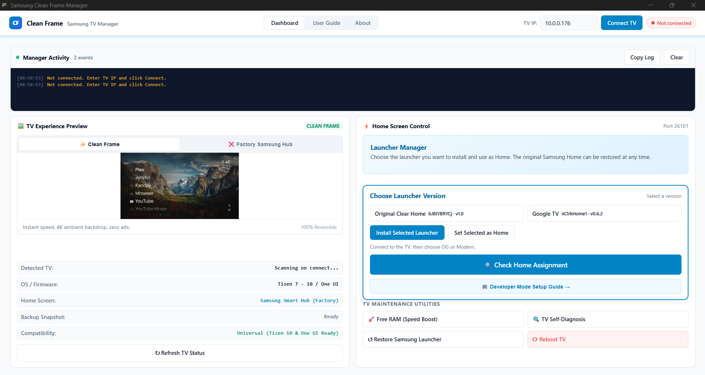

# CleanFrame Manager

CleanFrame Manager is an independent experimental research-and-development project for studying and improving user-controlled Samsung Tizen TV home-screen workflows. It provides a guided Windows workflow for connecting to a TV in Developer Mode, reviewing installed content, and configuring an alternative launcher experience where supported.

> Use this project only on a television you own or are authorized to administer. TV firmware, model support, and available developer capabilities vary. Make a recovery plan before changing launcher or application settings.

> **Unofficial project:** CleanFrame Manager is independent software and is not affiliated with, endorsed by, or sponsored by Samsung Electronics Co., Ltd. Samsung and Tizen are trademarks of their respective owners.



*CleanFrame Manager application screenshot for documentation and presentation. This is the CleanFrame Manager desktop application, not a photograph of a Samsung TV and not an official Samsung interface.*

## Current status

This is an early, model-specific release (`v0.1.0-alpha`). Treat it as experimental software. A successful connection, temporary elevated access, or a visible launcher change on one television does not prove compatibility with every Samsung TV.

The guided interface is currently provided by `tv_manager_v3.html` and the Windows backend by `manager_window.py`. The project includes checkpoints and status reporting, but some removal operations may remain intentionally guarded or unavailable depending on the TV.

CleanFrame Manager is intended to help create a cleaner, less distracting TV home-screen experience. It is not an official Samsung utility and does not guarantee compatibility, continued operation after firmware updates, or preservation of warranty coverage.

## Features

- Guided Samsung TV connection workflow
- Developer Mode and connection-status checks
- TV identity and firmware information when available
- Recovery-oriented checkpoints before risky actions
- Alternative launcher configuration where supported
- Windows desktop interface

## Requirements

- Windows 10 or Windows 11
- A Samsung Tizen TV that you own or administer
- TV and computer on the same network
- Samsung TV Developer Mode enabled
- Python 3.11 for running from source, or a project-provided installer when released
- Network access permitted between the computer and TV

## Run from source

```powershell
Set-Location -LiteralPath 'D:\Samsung TV Project\CleanFrame Manager Workspace'
python manager_window.py
```

The exact connection and Developer Mode steps depend on the TV model and Tizen version. Follow the on-screen checks and do not continue when the application reports that a prerequisite is missing.

## Safety and recovery

CleanFrame Manager can affect the TV's application and launcher environment. Before using it:

1. Record the TV model, firmware version, and current launcher state.
2. Confirm that you can restore the original launcher or perform a TV reset if necessary.
3. Keep the original launcher and required recovery files available.
4. Use one checkpoint at a time and verify the TV after each change.
5. Stop if the TV identity, connection state, or permissions do not match the expected result.

Use only on a television you own or are authorized to administer. Do not use the project to access another person's TV, bypass access controls, or interfere with Samsung services or other users' devices.

Temporary elevated access should be treated as temporary. Do not assume that it survives a reboot or remains available after a firmware update.

## Supported models

There is no universal support guarantee yet. Compatibility reports should include:

- Exact TV model code
- Tizen version and firmware version
- Developer Mode status
- CleanFrame Manager version
- The exact step that succeeded or failed
- Relevant application log output with personal information removed

## Project layout

```text
manager_window.py              Windows application backend
tv_manager_v3.html             Current guided interface
SamsungCleanFrameManager.spec  PyInstaller build configuration
CleanFrameManager-Setup.iss    Inno Setup configuration
cleanframe-manager-screenshot.png  CleanFrame Manager application screenshot for documentation
```

Build output, installers, signed TV packages, local certificates, and machine-specific files are excluded from the source repository by default. Check ownership and redistribution rights before adding any third-party package or Samsung-derived asset.

## Contributing

Please open an issue before submitting a large change. Do not include private TV addresses, credentials, certificates, signing keys, or logs containing personal information.

## License

This project is released under the MIT License. See [LICENSE](LICENSE).

## Disclaimer

This software is provided without warranty. The authors are not responsible for data loss, application loss, launcher failure, warranty impact, firmware problems, service interruption, or other damage resulting from its use. Samsung Electronics Co., Ltd. has not reviewed or approved this project.

The repository's screenshots, icons, wallpapers, and other media must be original, appropriately licensed, or used with permission. Third-party product names and logos remain the property of their respective owners and do not indicate endorsement.
